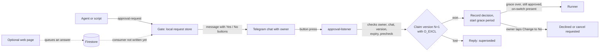

# exactly-once-approval-gate

A small gate that asks one human a yes/no question before an automated job does something that matters, and records the answer exactly once.

## The problem

Agents and scripts can prepare work, but some actions should not happen until a person says yes: uploading a build, sending something, changing a live system. A plain "reply Y to continue" message is not enough:

- A double tap, a retry or two processes racing can apply the same answer twice.
- An old message can be answered after the situation has changed.
- Someone else in the chat can press the button.
- A crash between "answer received" and "answer saved" can lose or repeat the decision.
- The person may want to change their mind a minute later.

This gate handles those cases on one machine, with the Python standard library only.

## How it works



1. Something calls `bin/approval-request <kind> ...`. The gate stores the request as a JSON file with version 0 and a 12-hour expiry, and sends a Telegram message with Yes and No buttons. Each request also carries a risk block (what it reaches, how to undo it, evidence). A request with an incomplete risk block expires without asking.
2. `bin/approval-listener` long-polls Telegram. For each button press it checks, in order: the sender is the configured owner, the chat is the configured private chat, the button belongs to the current version and the current message, the action is allowed in the current state, and the request has not expired. It then runs the kind's precheck (the example checks that `main` has not moved).
3. A decision is a new version. The gate creates `<id>.v<N+1>.claim` with `O_CREAT | O_EXCL` under a file lock. Only one writer can create it, so only one answer wins. On load, claim files are replayed in order, so a crash between the claim and the main record is repaired. A half-written claim stops the gate ("manual recovery required") rather than guessing.
4. Yes starts a grace period (default 2 minutes). The new message has a "Change to No" button. After the grace period the listener launches the kind's runner, passing the bot token on stdin only. A "No" after launch becomes `cancel_requested`, which the runner checks.
5. Every transition is written to an audit log (with the token and chat ID scrubbed), a human-readable decisions log, and an append-only ledger for later review of how answers were given.

The `web/` folder is an optional second channel: a Firebase page where the owner signs in with Google and queues an answer. The Cloud Function never changes the decision itself. It only queues an answer tagged with the version it saw. The local gate stays the only place where decisions are made. `web/CONTRACT.md` specifies how the local side should consume those answers.

## Design rules

- **Agents draft, humans decide.** The gate never approves anything by itself. Timeouts, a moved `main` and failed sends all end in "expired", never "approved".
- **Exactly once.** One version, one claim file, one winner. Every button carries the version it was sent with, so an answer to an old message is rejected as superseded.
- **Staged autonomy.** A real runner only starts if an on-switch file (`<kind>.enabled`) exists in the state directory. Without it, an approved request is recorded and reported as "runner disabled, nothing built". Test requests only ever take the dry-run path.
- **Fail closed.** Missing config, missing token, missing repo URL, an unreadable claim or an unverifiable precheck all stop the action. Failed alerts and ledger writes never undo a decision.
- **Keep secrets out of logs.** The bot token and chat ID are registered as secrets and scrubbed from every audit line and error message. Foreign Telegram user IDs are stored only as hashes.

## What it does not do

- It does not decide anything. It records what one person decided.
- It does not support more than one approver, or groups.
- The included `tester-upload` runner is a stub. It does nothing real. You supply the real action.
- The local consumer for web answers is specified in `web/CONTRACT.md` but not written. Until it exists, web answers are queued and never applied.
- It is not a workflow engine or a queue. It runs on one machine and uses file locks, so do not share its state directory over a network file system.

## Setup

Requirements: Python 3.9 or later on macOS or Linux (it uses `fcntl`). No packages to install.

1. Create a Telegram bot with BotFather and start a private chat with it.
2. Create the state directory and config:

   ```sh
   mkdir -p ~/.agent-state/approvals && chmod 700 ~/.agent-state/approvals
   cp gate/config.example.json ~/.agent-state/approvals/config.json
   ```

   Put your numeric Telegram user ID in `owner_user_id` and your private chat ID in `chat_id`.
3. Provide the token through the environment, from your own secret store:

   ```sh
   export APPROVALS_TG_TOKEN="<your bot token>"
   ```

4. Try it with the test kind:

   ```sh
   bin/approval-request test-echo --note "hello"
   bin/approval-listener          # leave running; press Yes in Telegram
   ```

   After the grace period, `bin/approval-runner-test-echo` runs and reports back in the chat.

5. To run the listener all the time, use your service manager (launchd, systemd). Run only one listener per bot: a second poller makes Telegram return HTTP 409, and the listener stops with exit code 3.

## Configuration

| Setting | Where | Meaning |
| --- | --- | --- |
| `owner_user_id`, `chat_id` | `config.json` in the state directory | The only user and private chat whose button presses count. Both must be integers. |
| `APPROVALS_TG_TOKEN` | environment | Bot token. Required. |
| `APPROVALS_STATE_DIR` | environment | State directory. Default `~/.agent-state/approvals`. |
| `APPROVALS_GRACE_SECONDS` | environment | Time between Yes and launch. Default 120. |
| `APPROVALS_TZ` | environment | Time zone for messages and the decisions log. Default `UTC`. |
| `APPROVALS_REPO_URL` | environment | Git remote checked by the `tester-upload` precheck. If unset, the precheck fails and nothing is approved. |
| `APPROVALS_RUNNER_DIR` | environment | Where `approval-runner-<kind>` scripts live. Default `bin/` in this repo. |
| `APPROVALS_DECISIONS_LOG` | environment | Path of the readable decisions log. Default `decisions.md` in the state directory. |
| `APPROVALS_HEARTBEAT` | environment | Optional command called as `<cmd> <name> <status> <code>` for health monitoring. |
| `<kind>.enabled` | file in the state directory | On-switch for a real runner. Absent means approved requests do not run. |

To add your own action, add an entry to `KINDS` in `gate/approvals.py` with a render function, a precheck, a risk block and a runner script.

For the web channel, see `web/README.md`. It needs a Firebase project, Google sign-in, App Check and its own configuration. Every value in `web/config.example.json` is a placeholder, and the deploy check refuses to run while any placeholder is left.

## Tests

```sh
python3 -m unittest discover -s tests          # gate: offline, no network or subprocesses
cd web && npm run test:render                  # page rendering helpers
cd web/functions && npm ci && npm run test:unit
cd web && npm run test:emu                     # needs the Firebase CLI and Java 21; uses a local demo project
```

All tests use synthetic data and fake transports.

## Limitations

- Single machine, single owner, single Telegram chat.
- Telegram long polling only, no webhook.
- The request store is a directory of JSON files. It is meant for a handful of requests a day, not thousands.
- The web channel has been tested only against the Firebase emulator.

## Status

Used on a private project. The Telegram gate has been run in supervised dry runs: test-echo requests from start to finish, and test-mode requests for the example action. The real action behind the example was built but never switched on. The web channel is built and passes its emulator tests, but has not been deployed, and the local consumer for web answers has not been written. This repository is the generic part of that work, with the project-specific runner removed.

## License

MIT. See `LICENSE`.
